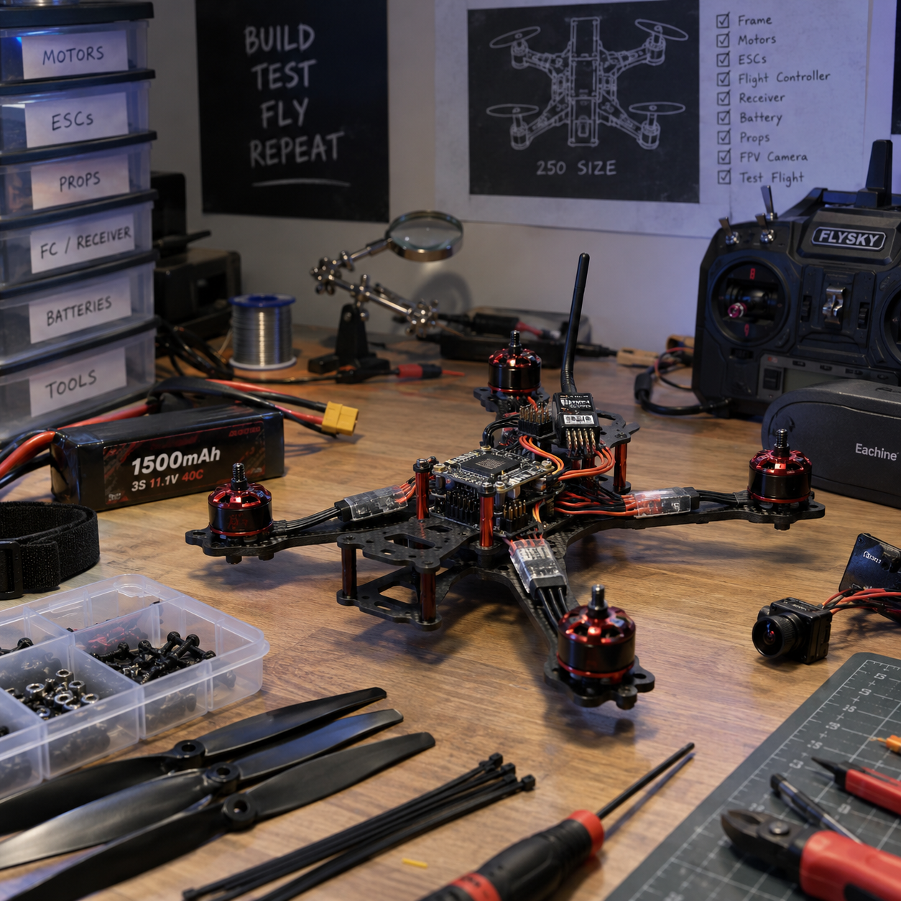
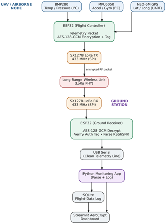
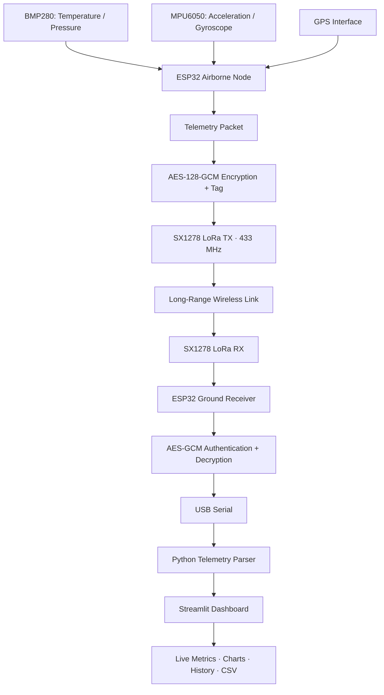
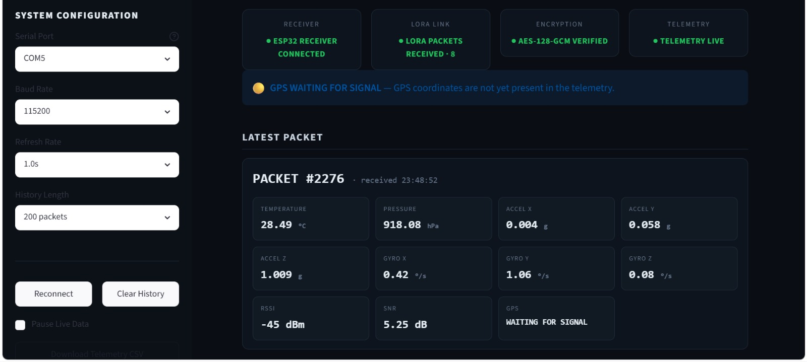
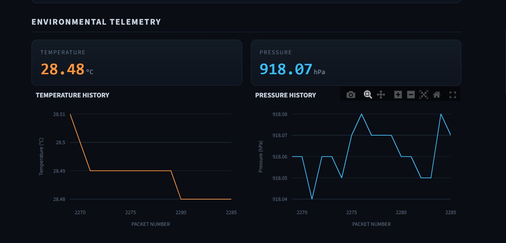
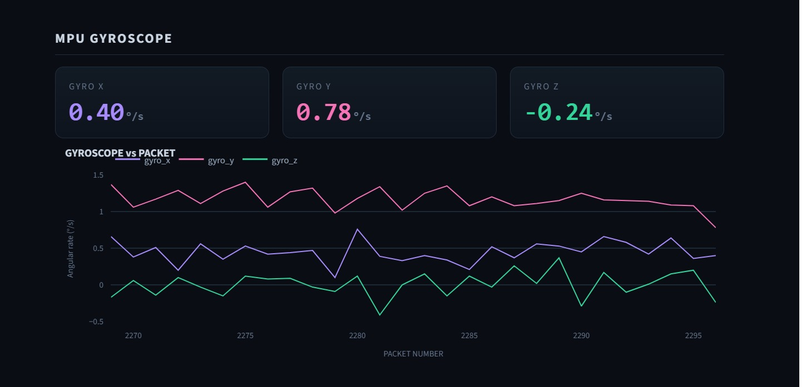
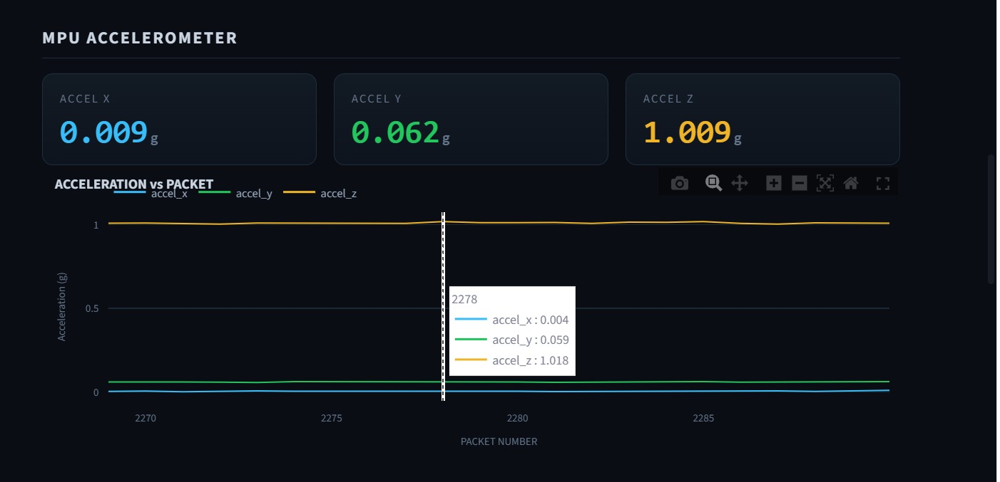
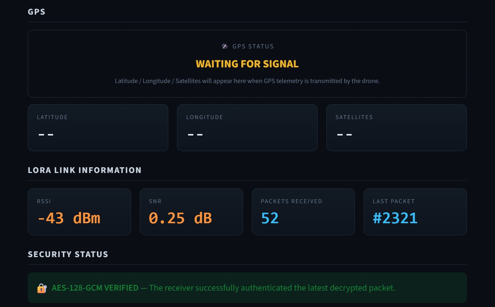

# AeroCrypt
### AES-128-GCM Secured Long-Range UAV Telemetry & Ground Monitoring System

<p align="center"></p>

<p align="center"><b>SECURE SENSING · AUTHENTICATED TELEMETRY · 433 MHz LoRa · LIVE GROUND-STATION VISUALIZATION</b></p>

AeroCrypt is an embedded telemetry and remote-monitoring platform that connects an airborne sensing node to a ground station through a long-range LoRa wireless link. It integrates sensor acquisition, embedded packet processing, AES-128-GCM authenticated encryption, wireless transmission, receiver-side verification, serial telemetry delivery and a live Python dashboard.

The system is designed around a clear engineering principle: **authenticate telemetry at the receiving edge before making it available to the monitoring application.**

## System at a glance

| Subsystem | Implementation |
|---|---|
| Airborne controller | ESP32 |
| Environmental sensing | BMP280 — temperature and atmospheric pressure |
| Motion sensing | MPU6050 — 3-axis acceleration and angular velocity |
| Positioning interface | NEO-6M GPS integration and extended telemetry schema |
| Radio | SX1278 LoRa transceiver, 433 MHz |
| Wireless security | AES-128-GCM authenticated encryption |
| Ground receiver | ESP32 + SX1278 |
| Host interface | USB serial, 115200 baud |
| Monitoring | Python, Streamlit, Pandas, Plotly |
| Export | CSV telemetry history |

## System architecture

<p align="center"></p>



## Core capabilities

- **Authenticated telemetry:** AES-128-GCM protects the sensor payload and enables the receiver to reject packets that fail authentication.
- **Long-range wireless link:** SX1278 LoRa communication at 433 MHz connects the airborne node and ground station.
- **Multi-sensor monitoring:** Temperature, pressure, acceleration and angular velocity are collected and presented as live telemetry.
- **Receiver-side verification:** The ground ESP32 verifies the GCM authentication tag before forwarding plaintext telemetry to the host.
- **Communication diagnostics:** Packet-level RSSI and SNR are displayed alongside receiver and security status.
- **Live dashboard:** Streamlit presents the latest packet, sensor cards, time-series plots, packet history and export controls.
- **Portable data:** Captured telemetry can be downloaded as CSV for offline analysis.

## Repository structure

```text
AeroCrypt/
├── firmware/
│   ├── uav_transmitter/
│   │   ├── AeroCrypt_UAV_Transmitter.ino
│   │   └── platformio.ini
│   └── ground_receiver/
│       ├── AeroCrypt_Ground_Receiver.ino
│       └── platformio.ini
├── dashboard/
│   ├── app.py
│   ├── aerocrypt/
│   │   ├── __init__.py
│   │   ├── protocol.py
│   │   └── serial_reader.py
│   ├── tests/test_protocol.py
│   ├── .streamlit/config.toml
│   └── requirements.txt
├── hardware/
├── docs/
│   ├── hardware-setup.md
│   ├── operation-guide.md
│   ├── packet-protocol.md
│   └── security-architecture.md
├── documentation/
│   ├── AeroCrypt_Project_Report.pdf
│   ├── EXPERIMENTAL_RESULTS.md
│   └── architecture/
├── screenshots/
├── samples/
├── .github/workflows/dashboard-tests.yml
├── CONTRIBUTING.md
├── CITATION.cff
├── LICENSE
├── SECURITY.md
└── README.md
```

## Quick start — ground dashboard

Python 3.10 or newer is recommended.

```bash
git clone https://github.com/<your-username>/AeroCrypt.git
cd AeroCrypt
python -m venv .venv
```

Activate the environment:

```powershell
# Windows PowerShell
.venv\Scripts\Activate.ps1
```

```bash
# Linux / macOS
source .venv/bin/activate
```

Install dependencies and launch the dashboard:

```bash
pip install -r dashboard/requirements.txt
streamlit run dashboard/app.py
```

Open the local Streamlit URL shown in the terminal. Select **Demo mode** to explore the interface, or choose **Serial mode**, select the ESP32 receiver's COM/serial port, and connect at 115200 baud.

## Firmware build

The two ESP32 firmware folders include PlatformIO project configuration. Open each folder in VS Code with PlatformIO or use the CLI:

```bash
cd firmware/ground_receiver
pio run
pio run --target upload
```

Flash the airborne node from its project folder:

```bash
cd firmware/uav_transmitter
pio run
pio run --target upload
```

The transmitter and receiver must use matching AES key material and matching LoRa radio settings. The committed key is a development/demo value; provision unique secret key material for a deployment.

## Hardware and interfaces

| Device | Interface | Function |
|---|---|---|
| BMP280 | I²C | Temperature and pressure |
| MPU6050 | I²C | Acceleration and angular velocity |
| NEO-6M GPS | UART | Position and satellite data interface |
| SX1278 | SPI | LoRa radio interface |
| Ground ESP32 → PC | USB serial | Authenticated telemetry and link diagnostics |

Ground receiver GPIO mapping and radio configuration are documented in [`hardware/ground_receiver_pins.md`](hardware/ground_receiver_pins.md).

## Telemetry data format

The current base telemetry payload contains nine comma-separated fields:

```text
packet,temp,pressure,ax,ay,az,gx,gy,gz
```

| Field | Description | Unit |
|---|---|---|
| `packet` | Transmitter sequence number | count |
| `temp` | BMP280 temperature | °C |
| `pressure` | BMP280 atmospheric pressure | hPa |
| `ax`, `ay`, `az` | MPU6050 acceleration | g |
| `gx`, `gy`, `gz` | MPU6050 angular velocity | °/s |

The parser also supports an extended GPS schema containing latitude, longitude, satellite count and HDOP. See [`docs/packet-protocol.md`](docs/packet-protocol.md).

## Security architecture

AeroCrypt uses AES-128-GCM, combining confidentiality with integrity/authenticity verification. The airborne ESP32 generates a 96-bit nonce for each packet using the ESP32 hardware random-number generator. The radio frame contains a magic marker, protocol version, nonce, ciphertext and 128-bit authentication tag.

At the ground station, the receiver validates the frame, extracts the cryptographic fields and performs authenticated decryption. Only successfully authenticated telemetry is forwarded to the host serial interface. Security details are documented in [`docs/security-architecture.md`](docs/security-architecture.md).

## Dashboard preview

<p align="center"></p>

<table>
<tr>
<td width="50%"><p align="center"><b>Environmental telemetry</b></p></td>
<td width="50%"><p align="center"><b>Gyroscope telemetry</b></p></td>
</tr>
<tr>
<td><p align="center"><b>Accelerometer telemetry</b></p></td>
<td><p align="center"><b>Security and GPS status</b></p></td>
</tr>
</table>

## Captured experimental observations

A captured monitoring session includes BMP280 and MPU6050 telemetry, packet sequencing, LoRa RSSI/SNR and AES-128-GCM verification status. A separate reported line-of-sight field run recorded approximately 500 m communication distance and approximately 93% packet delivery under its tested configuration. Representative observations are summarized in [`documentation/EXPERIMENTAL_RESULTS.md`](documentation/EXPERIMENTAL_RESULTS.md).

## Run the parser tests

```bash
cd dashboard
python -m unittest discover -s tests -v
```

The test suite covers the base and extended telemetry schemas, numeric validation, LoRa link metrics and security status parsing.

## Documentation

- [Hardware setup](docs/hardware-setup.md)
- [Operation guide](docs/operation-guide.md)
- [Packet protocol](docs/packet-protocol.md)
- [Security architecture](docs/security-architecture.md)
- [Hardware components](hardware/components.md)
- [Project report](documentation/PROJECT_REPORT.md)

## Author

**Rishi P.** · Electronics & Communication Engineering

---

*AeroCrypt — Secure UAV Telemetry and Remote Monitoring.*
